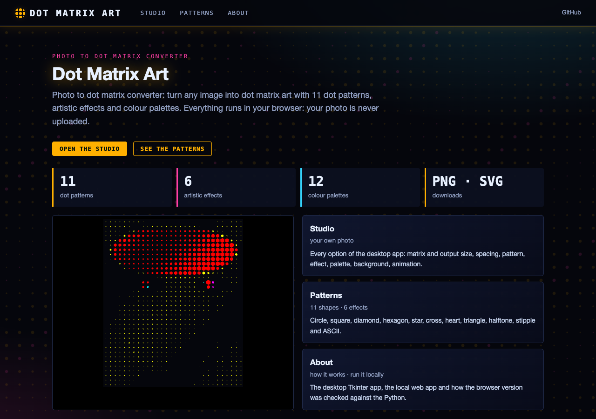
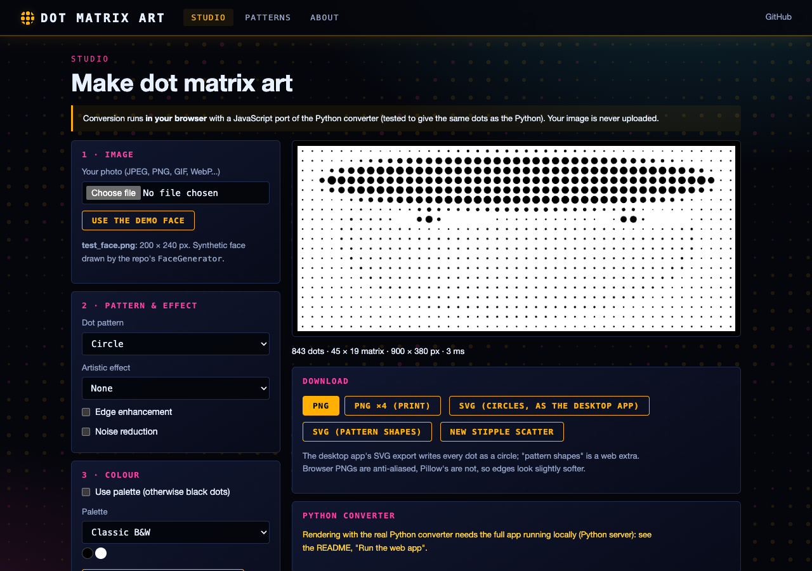
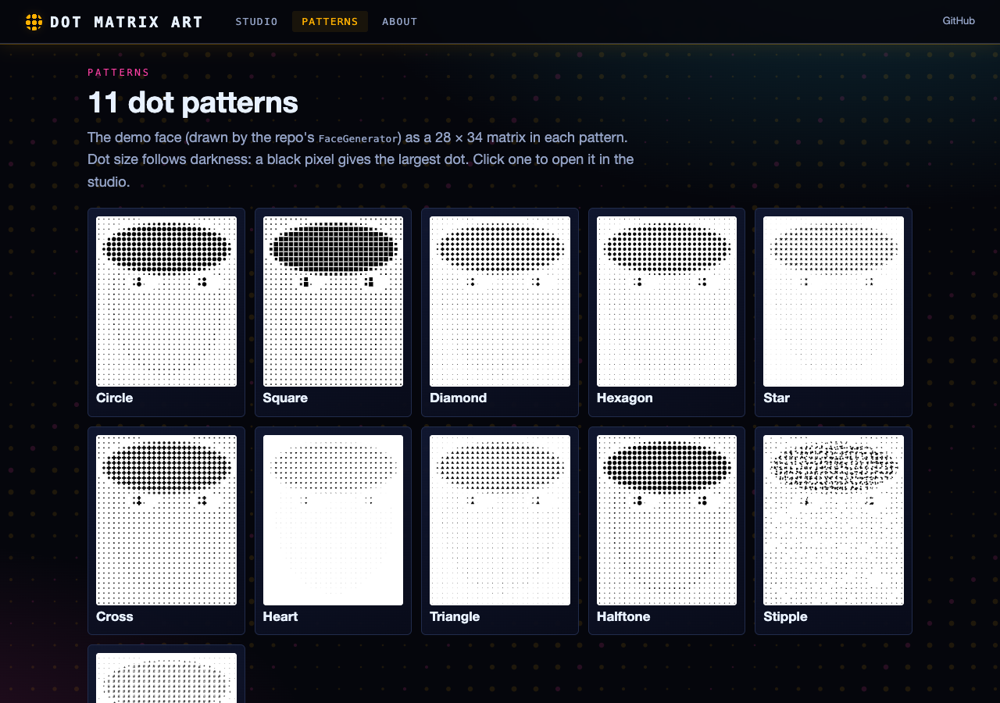

# Dot Matrix Art

A photo-to-dot-matrix converter with a full-featured Tkinter GUI. Transform any image into dot matrix art using a variety of dot patterns, artistic effects, and export options.


## Features

- **11 dot pattern types**: circle, square, diamond, hexagon, star, cross, heart, triangle, halftone, stipple, ASCII
- **Artistic effects** with configurable parameters
- **Real-time preview** in the GUI
- **Camera capture** support (requires OpenCV)
- **Face detection** for intelligent cropping (requires OpenCV)
- **Batch processing** and export
- **Project save/load** via JSON
- **Multi-threaded** processing for responsive UI

## Web app and static site

Try it in the browser: **https://gddickinson.github.io/dotMatrix_art/** (static site, published from `main` by
`.github/workflows/pages.yml`). Pick your own photo: the conversion runs in your browser with a JavaScript port of the
Python converter, and the image is never uploaded. Every option of the desktop app is there (matrix and output size,
spacing, 11 patterns, effects, edge enhancement, noise reduction, palettes including "extract from image", custom
background, animation) with PNG and SVG downloads.

| Home | Studio | Patterns |
|---|---|---|
|  |  |  |

### Run the web app

```bash
pip install -r requirements-web.txt
python run_web.py            # http://127.0.0.1:8157
```

The local app has the same pages plus **Render with Python**, which sends the image to the local server and runs the
repo's own `AdvancedDotMatrixConverter` (PNG and the desktop SVG export come back).

How the JS port was checked: `scripts/make_dm_fixture.py` runs the Python on a generated test image and writes
`tests/fixtures/dm_fixture.json`; `dot_matrix/web/static/dm_engine.test.mjs` (node) runs the port on the same pixels.
Effect images, brightness matrices, palette colours, the dot list, the SVG export text and the shape geometry agree
exactly. Drawn PNGs differ slightly: browsers anti-alias, Pillow does not, and stipple uses a different random
generator.

```bash
python -m pytest -q tests/test_web.py test_patterns.py    # includes the node test
python scripts/build_static.py                             # static site -> site/
```

## Requirements

- Python 3.7+
- Pillow (PIL)
- NumPy
- tkinter (included with Python)
- OpenCV (optional, for camera and face detection)

```bash
pip install Pillow numpy opencv-python
```

## Usage

```bash
# Run the desktop app (modular package dot_matrix/)
python app.py

# The original single-file v3 app still works too
python photo_to_dot_matrix_v3.py
```

### Workflow

1. Load an image via the GUI file dialog
2. Choose a dot pattern type
3. Adjust dot size, spacing, and artistic effects
4. Preview the result in real time
5. Export the dot matrix art (PNG/JPEG, SVG, high-resolution PNG, animation frames)

Artistic effects (applied before sampling): Vintage (softer contrast + sepia), Neon (strong edges, contrast,
saturation), Watercolor (blur, 16 levels per channel, richer colour), Sketch (colour-dodge style pencil), Comic
(4-level poster colours with black ink edges), Emboss, Sepia (classic sepia matrix), Crosshatch (edge lines),
Mosaic (20 px blocks) and Depth 3D (red/cyan anaglyph shift of 1% of the width).

## Versions

| File | Description |
|------|-------------|
| `_archive/photo_to_dot_matrix_v1.py` | Original version |
| `_archive/photo_to_dot_matrix_v2.py` | Added more patterns and effects |
| `photo_to_dot_matrix_v3.py` | Full GUI with camera, face detection, batch processing (single file, kept for compatibility) |
| `app.py` + `dot_matrix/` | The v3 app split into modules (current) |

## Project Structure

```
dotMatrix_art/
├── app.py                      # Entry point: launches the Tkinter GUI
├── dot_matrix/                 # Package: models, patterns, effects, camera, batch, project_io, gui_*
├── photo_to_dot_matrix_v3.py   # Legacy single-file v3 app
├── test_patterns.py            # Tests (pytest)
├── _archive/                   # v1 and v2
├── examples/
│   └── dot_matrix_example.png  # Example output
└── README.md
```

Projects and gallery images are saved to `dot_matrix_projects/` (created at run time). See `INTERFACE.md` for a
module map.

---
*Built with AI assistance from [Claude (Anthropic)](https://claude.com/).*
